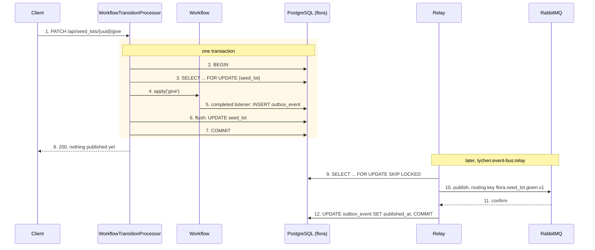
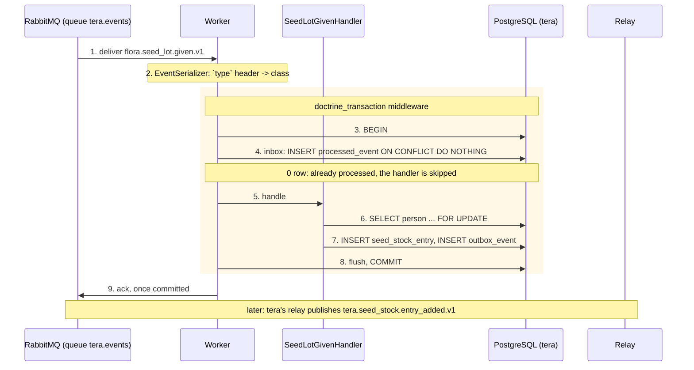

# lychen/event-bus

Events between the Lychen APIs, over the central RabbitMQ (`projects/common/rabbitmq`).

A service records an event in the transaction of the change it reports (a **transactional
outbox**). A relay, in a process of its own, publishes it on the platform's topic exchange
`lychen.events`, its type as routing key. The broker delivers it to the queue of every
service whose queue is bound to that routing key. There, a Messenger worker handles it at
most once, in one transaction with its record in the **inbox**. The handler can record
events of its own in its outbox in that same transaction.

The example: flora's seed library gives a lot (`flora.seed_lot.given.v1`), and tera adds it
to the member's seed stock, then publishes `tera.seed_stock.entry_added.v1`.

## The flow

The producer: the event is written by the transaction that gives the lot, and published
later, by another process.



The consumer: one transaction for the inbox record, the change and the next event.



If the handler throws, the transaction rolls back, inbox record included: the message is
retried after 2 s, 10 s, then 60 s, then sent to the failure transport.

## What it guarantees

- **Atomic**: an event is published if, and only if, the change it reports is committed.
  The request never waits on the broker, and works while the broker is down.
- **At least once**: the relay publishes, waits for the broker's confirm, marks the event
  published, then commits. A crash in between publishes the event again, so it can arrive
  twice, never zero times.
- **Handled once per service**: the inbox's primary key on the event id turns a second
  delivery into a no-op (the handlers are skipped, the message is acknowledged). Two workers
  that get the same event at once queue on that key.
- **No ordering**: events of different transactions can be published out of order, and a
  retry overtakes nothing in particular. A consumer relies on its own state (workflow
  guards, unique keys) rather than on the order of arrival.

## On the wire

```
routing key   flora.seed_lot.given.v1
properties    message_id=<event id>, type=flora.seed_lot.given.v1, app_id=flora,
              content_type=application/json, timestamp=<occurred at>
headers       type=flora.seed_lot.given.v1, event_id=<uuid v7>, event_producer=flora,
              event_occurred_at=2026-11-08T10:00:00+00:00
body          {"seedLot":"0199...","seedLibrary":"0199...","variety":"Fève","harvestYear":2025,
               "quantityInGrams":120,"recipient":"312987...","givenAt":"2026-11-08T10:00:00+00:00"}
```

Plain JSON and plain headers, readable whatever the consumer's language. The services share
this format, never PHP code: each one declares its own class for the events it publishes,
and its own copy, limited to the fields it reads, of those it consumes.

## Naming and versions

An event's type is its routing key: `<domain>.<aggregate>.<action>.v<n>`, in snake_case,
the action in the past tense (`flora.seed_lot.given.v1`). The domain is the producer's:
`Outbox::record()` refuses any other prefix, and so does the broker, whose topic permissions
only let a service publish under its own domain. `<domain>.internal.*` is reserved for the
service's own background work.

Adding a field is compatible: consumers ignore what they do not declare. Removing, renaming
or retyping one is a new version, `flora.seed_lot.given.v2`, published alongside v1 until no
service is bound to v1 any more.

## Publishing an event

Declare the event, with its type as serialized type name:

```php
#[AsMessage(serializedTypeName: 'flora.seed_lot.given.v1')]
final readonly class SeedLotGiven
{
    public function __construct(
        public Uuid $seedLot,
        public string $variety,
        public ?string $recipient,
        public \DateTimeImmutable $givenAt,
    ) {
    }
}
```

and record it where the change happens, before the flush that writes the change:

```php
#[AsCompletedListener(workflow: 'seed_lot', transition: 'give')]
public function onGiven(Event $event): void
{
    $this->outbox->record(new SeedLotGiven(...));
}
```

`Outbox::record()` only persists: the caller's flush writes the event, in the caller's
transaction. Recorded from a workflow listener, it commits with the transition, which
lychen/api's `WorkflowTransitionProcessor` runs in one transaction. Elsewhere, record it in
the same unit of work as the change: a handler (`doctrine_transaction` flushes it), a state
processor, or your own `wrapInTransaction()`.

## Consuming an event

1. Declare tera's copy of the event, with the producer's type, and the fields tera reads:

   ```php
   #[AsMessage(serializedTypeName: 'flora.seed_lot.given.v1')]
   final readonly class SeedLotGiven { public function __construct(public Uuid $seedLot, ...) {} }
   ```

2. Handle it with a plain Messenger handler. It runs inside the transaction, after the
   inbox: do the change, record the events that follow, throw to retry.

   ```php
   #[AsMessageHandler]
   final readonly class SeedLotGivenHandler { public function __invoke(SeedLotGiven $event): void { ... } }
   ```

3. Subscribe the service's queue to it in `projects/common/rabbitmq/subscriptions.conf`
   (`tera flora.seed_lot.given.v1`), and restart the broker.

An event that reaches the queue without a class to read it (a broader binding, a version
the service does not read yet) is acknowledged with a warning instead of failing forever
(`UnknownEvent`), and so is an event with a class but no handler (the service's own event,
routed back by a binding left over from `<service>.#`).

A message that reaches the service under another domain's routing key must be that domain's
event, its type equal to its routing key: anything else is refused without retry
(`ForeignMessageGuardMiddleware`). The broker's topic permissions only check the routing key a
service publishes under, not what the message claims to be.

## What it holds

| Class | Role |
| --- | --- |
| `Outbox\Outbox` | Records an event in the outbox, serialized right away, for the caller's flush to write. |
| `Outbox\OutboxRelay` | Publishes the committed events, oldest first, a batch per transaction (`FOR UPDATE SKIP LOCKED`), each confirmed by the broker before it is marked published. |
| `Command\RelayCommand` | `lychen:event-bus:relay`, the relay's long-running process: drains the outbox, then polls it every 500 ms. |
| `Command\PurgeCommand` | `lychen:event-bus:purge`: deletes the events published more than 7 days ago, and the inbox records older than 30 days. |
| `Serializer\EventSerializer` | The transport serializer: Messenger's JSON serializer, plus the event headers, the outbox payload sent as is, and `UnknownEvent`. |
| `Middleware\ForeignMessageGuardMiddleware` | Refuses a message received under another domain's routing key unless it is an event typed after that routing key. |
| `Middleware\InboxMiddleware` | The inbox: records the event in `processed_event` inside the bus's transaction, and skips the handlers when it is already there. |
| `Stamp\IntegrationEventStamp` | The identity of a received event (id, type, producer, date), read from its headers. |
| `Retry\FixedDelaysRetryStrategy` | Retries after each of a list of delays (2 s, 10 s, 60 s), which Messenger's multiplier cannot express. |
| `Entity\OutboxEvent`, `Entity\ProcessedEvent` | The `outbox_event` and `processed_event` tables. |
| `Message\UnknownEvent`, `Handler\UnknownEventHandler` | An event no class of the service declares, acknowledged with a warning. |
| `LychenEventBusBundle` | Registers the services; the API's config files use them explicitly. |

## Wiring an API

flora-api (producer) and tera-api (consumer and producer) are wired this way.

1. `composer.json`: require `"lychen/event-bus": "*"` and add it to the `versions` of the
   `../packages/*` path repository, then `composer update lychen/event-bus`.
2. `moon.yml`: add `lychen-php-event-bus` to `dependsOn`.
3. `config/bundles.php`: `Lychen\EventBus\LychenEventBusBundle::class => ['all' => true]`.
4. `config/packages/lychen_event_bus.php`: `'producer' => '<domain>'`, and `'transport'` if
   the service's queue transport is not `async`.
5. `config/packages/doctrine.php`: map `%kernel.project_dir%/vendor/lychen/event-bus/src/Entity`
   (prefix `Lychen\EventBus\Entity`), then generate the migration (`outbox_event`,
   `processed_event`).
6. `config/packages/messenger.php`, on the transport of the service's queue and its bus:
   - `'default_serializer' => 'lychen_event_bus.serializer'`, with the Symfony serializer in
     JSON;
   - `'confirm_timeout' => 5` in the transport's options: without it the sender returns
     before the broker has the message, and the relay could mark a lost event published;
   - `'retry_strategy' => ['service' => 'lychen_event_bus.retry_strategy']`;
   - the bus middleware `['lychen_event_bus.middleware.guard', 'doctrine_ping_connection',
     'doctrine_transaction', 'lychen_event_bus.middleware.inbox']`, in that order: the guard
     refuses before anything runs, the worker's connection is checked before the transaction,
     and the inbox needs the transaction.
7. `compose.yml`: the `worker` (`messenger:consume async`) and `outbox-relay`
   (`lychen:event-bus:relay`) services, on the api's image and environment, with `init: true`.
8. `projects/common/rabbitmq/subscriptions.conf`: one line per event the service consumes.

## Running it

- The worker and the relay run as their own containers, next to the api (`compose.yml`),
  and stop after an hour to be restarted fresh. In dev they run the mounted sources:
  `docker compose -p <api>-api restart worker outbox-relay` after a change to a handler.
- A failed event is listed by `messenger:failed:show` and replayed by
  `messenger:failed:retry`: it keeps its event id, so the inbox still deduplicates it.
- `lychen:event-bus:purge` keeps the two tables small; nothing schedules it yet.
- The relay stops between two batches on SIGTERM when PHP has the pcntl extension, which the
  API images lack: SIGTERM then ends it at once (`init: true` keeps php from being PID 1,
  which would ignore the signal until the SIGKILL 10 s later). That is safe: the batch's
  transaction rolls back, and at worst an event already confirmed is published again.
- Deploy the broker before a new subscription's producer: until the binding exists, the
  broker confirms the producer's events and drops them, as nothing routes them (they are not
  published as mandatory), and the relay marks them published.

## Limits

- PostgreSQL only: the inbox uses `INSERT ... ON CONFLICT DO NOTHING`, the relay
  `FOR UPDATE SKIP LOCKED`.
- One entity manager: the events must be written by the connection of the business change.
- One event that can never be published (the broker refusing it every time) holds back the
  ones recorded after it: each batch starts again from the oldest unpublished event. There is
  no parking of a poison event yet.
- RabbitMQ also dead-letters into `<service>.events.dlq` one copy of every failed attempt,
  retried ones included: Messenger rejects the message it has just re-published for retry,
  and the queues dead-letter what is rejected. `messenger:failed:*` is the reliable view of
  definitive failures.

Locally, changes to this library reach an API only after `composer reinstall lychen/event-bus`
in it: the path repository mirrors the files rather than symlinking them.
